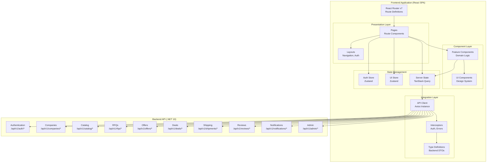

# Design Document: UI/UX Enhancement and Integration Audit

## Overview

This design addresses comprehensive visual modernization, responsive optimization, and backend integration verification for the DealZone B2B industrial raw materials marketplace frontend application. The enhancement preserves all existing functional workflows while delivering a premium, international-standard user experience through systematic implementation of the official DealZone brand identity, modern animation systems, responsive design patterns, and verified API contract adherence.

**Core Design Philosophy:**
- **Brand-First Visual Identity:** Strict adherence to official DealZone color palette, typography, and visual language
- **Responsive-by-Default:** Mobile-first design scaling seamlessly from 320px to 2560px+ viewports
- **Performance-Optimized:** Core Web Vitals compliance through lazy loading, code splitting, and optimized rendering
- **Contract-Verified Integration:** Source-code audit ensuring frontend API calls match backend DTO contracts exactly
- **Progressive Enhancement:** Layer visual improvements without breaking existing functionality

**Technology Context:**
- **Frontend Stack:** React 19.3.1 + Vite 8.3.6 + React Router 7.18.5
- **State Management:** Zustand 5.0.16 (global state) + TanStack Query 5.106.1 (server state)
- **Styling:** Tailwind CSS 4.3.4 with custom design tokens
- **Backend:** .NET 10 Web API with 84 documented REST endpoints
- **Integration Constraint:** SQL Server unavailable locally; verification via source-code audit only

---

## Architecture

### System Architecture Overview



### Design System Architecture

```mermaid
graph LR
    subgraph "Design System Foundation"
        Tokens[Design Tokens<br/>Colors, Typography, Spacing]
        Theme[Theme Configuration<br/>Tailwind Config]
    end
    
    subgraph "Component Library"
        Primitives[Primitives<br/>Button, Input, Card]
        Composites[Composites<br/>DataTable, Modal]
        Layouts[Layout Components<br/>Navigation, Footer]
    end
    
    subgraph "Animation System"
        Transitions[Transitions<br/>Page, Component]
        Micro[Micro-interactions<br/>Hover, Focus, Loading]
        Entrance[Entrance Effects<br/>Scroll-triggered]
    end
    
    subgraph "Responsive System"
        Breakpoints[Breakpoints<br/>sm, md, lg, xl, 2xl]
        FluidType[Fluid Typography<br/>clamp() scaling]
        GridSystem[Grid System<br/>Flexbox, CSS Grid]
    end
    
    Tokens --> Theme
    Theme --> Primitives
    Primitives --> Composites
    Composites --> Layouts
    Theme --> Transitions
    Theme --> Micro
    Theme --> Entrance
    Theme --> Breakpoints
    Breakpoints --> FluidType
    Breakpoints --> GridSystem
```

### Component Hierarchy

The application follows a strict component hierarchy ensuring separation of concerns:

**Level 1: Primitive Components** (`src/components/ui/`)
- Button, Input, Select, Checkbox, Radio
- Card, Badge, Tag, Chip
- Alert, Toast, Modal, Dialog
- Skeleton, Spinner, ProgressBar
- No business logic; pure presentation

**Level 2: Composite Components** (`src/components/composite/`)
- DataTable (with pagination, sorting, filtering)
- Form components (connected to react-hook-form)
- SearchBar, FilterPanel
- FileUpload with validation
- Chart wrappers (when library integrated)

**Level 3: Feature Components** (`src/components/features/`)
- RFQCard, OfferCard, DealCard
- CompanyVerificationStatus
- ShipmentTimeline
- ReviewForm, ReviewDisplay
- NotificationBell

**Level 4: Layout Components** (`src/components/layouts/`)
- MainLayout (with Navigation)
- AuthLayout (for login/register)
- DashboardLayout (with sidebar)
- PublicLayout (for marketing pages)

**Level 5: Page Components** (`src/pages/`)
- Route-level components
- Data fetching orchestration
- Layout composition

---

## Components and Interfaces

### 1. Design System Components

#### Color Token System

```typescript
// src/styles/tokens/colors.ts
export const colors = {
  // Primary Colors
  primary: {
    navy: '#06245B',      // DealZone Navy - main brand color
    cyan: '#00D9F5',      // DealZone Cyan - primary CTAs
    growthBlue: '#1266D6', // Growth Blue - interactive links
    white: '#FFFFFF',      // Pure white
  },
  
  // Secondary Colors
  secondary: {
    iceBlue: '#EAF4FF',   // Light backgrounds, badge fills
    cloudGray: '#F4F7FB',  // Main canvas background
    slateGray: '#64748B',  // Secondary text, labels
    deepBlue: '#123878',   // Dark hover states
  },
  
  // Status Colors
  status: {
    success: '#10B981',    // Approved, confirmed, delivered
    warning: '#F59E0B',    // Pending, awaiting
    error: '#EF4444',      // Rejected, disputed, failed
    info: '#3B82F6',       // Informational, in-transit
  },
  
  // Gradients
  gradients: {
    hero: 'linear-gradient(135deg, #06245B 0%, #1266D6 50%, #00D9F5 100%)',
    trust: 'linear-gradient(180deg, #041638 0%, #06245B 60%, #164B91 100%)',
  },
};
```

#### Typography System

```typescript
// src/styles/tokens/typography.ts
export const typography = {
  fontFamily: {
    arabic: "'Cairo', sans-serif",
    latin: "'Inter', sans-serif",
  },
  
  sizes: {
    h1: {
      fontSize: '32px',
      lineHeight: '40px',
      fontWeight: '700', // Bold
    },
    h2: {
      fontSize: '24px',
      lineHeight: '32px',
      fontWeight: '600', // Semibold
    },
    h3: {
      fontSize: '20px',
      lineHeight: '28px',
      fontWeight: '600', // Semibold
    },
    body: {
      fontSize: '16px',
      lineHeight: '24px',
      fontWeight: '400', // Regular
    },
    small: {
      fontSize: '14px',
      lineHeight: '20px',
      fontWeight: '400', // Regular
    },
    micro: {
      fontSize: '12px',
      lineHeight: '16px',
      fontWeight: '500', // Medium
    },
  },
  
  // Fluid typography using clamp()
  fluid: {
    h1: 'clamp(24px, 5vw, 32px)',
    h2: 'clamp(20px, 4vw, 24px)',
    h3: 'clamp(18px, 3vw, 20px)',
    body: 'clamp(14px, 2vw, 16px)',
  },
};
```

#### Spacing and Border Radii

```typescript
// src/styles/tokens/spacing.ts
export const spacing = {
  radii: {
    sm: '4px',
    md: '8px',     // Cards, inputs
    lg: '12px',    // Modals, containers
    full: '9999px', // Pills, badges
  },
  
  shadows: {
    soft: '0 4px 20px -2px rgba(6, 36, 91, 0.08)',
    card: '0 2px 8px -1px rgba(6, 36, 91, 0.06)',
    modal: '0 8px 32px -4px rgba(6, 36, 91, 0.12)',
  },
};
```

#### Button Component

```typescript
// src/components/ui/Button.tsx
interface ButtonProps {
  variant: 'primary' | 'secondary' | 'outline' | 'ghost' | 'danger';
  size: 'sm' | 'md' | 'lg';
  leftIcon?: ReactNode;
  rightIcon?: ReactNode;
  isLoading?: boolean;
  isDisabled?: boolean;
  children: ReactNode;
  onClick?: () => void;
}

// Implementation with Tailwind classes mapped to design tokens
// Primary button: bg-primary-cyan hover:bg-primary-growthBlue
// Secondary button: bg-secondary-iceBlue text-primary-navy
// Outline button: border-2 border-primary-navy text-primary-navy
```

#### Card Component

```typescript
// src/components/ui/Card.tsx
interface CardProps {
  variant: 'default' | 'elevated' | 'bordered';
  padding?: 'none' | 'sm' | 'md' | 'lg';
  hover?: boolean; // Enable hover elevation
  children: ReactNode;
}

// Implementation
// Default: bg-white rounded-lg shadow-soft
// Elevated: shadow-card hover:shadow-modal transition-shadow
// Bordered: border-2 border-secondary-cloudGray
```

#### Input Component

```typescript
// src/components/ui/Input.tsx
interface InputProps {
  type: 'text' | 'email' | 'password' | 'number' | 'tel';
  label?: string;
  error?: string;
  leftIcon?: ReactNode;
  rightIcon?: ReactNode;
  placeholder?: string;
  isDisabled?: boolean;
  isRequired?: boolean;
  value: string;
  onChange: (value: string) => void;
}

// Styling
// Base: rounded-md border-2 border-secondary-cloudGray
// Focus: border-primary-cyan ring-2 ring-primary-cyan/20
// Error: border-status-error
```

### 2. Navigation Components

#### Desktop Navigation Bar

```typescript
// src/components/layouts/Navigation/DesktopNav.tsx
interface NavItem {
  label: string;
  href: string;
  icon?: ReactNode;
  badge?: number; // For notification counts
  requiredRole?: CompanyRole[];
  requiredVerification?: boolean;
}

interface DesktopNavProps {
  user: UserProfile | null;
  navigationItems: NavItem[];
  onLogout: () => void;
}

// Structure
// - Logo (left) with link to dashboard
// - Primary nav items (center) with icons
// - User menu (right) with profile dropdown
// - Notification bell with unread count badge
// Fixed positioning: sticky top-0 z-50
// Background: bg-primary-navy text-white
// Height: h-16 (64px)
```

#### Mobile Navigation Bar

```typescript
// src/components/layouts/Navigation/MobileNav.tsx
interface MobileNavProps {
  user: UserProfile | null;
  navigationItems: NavItem[];
  onLogout: () => void;
}

// Structure
// - Fixed top bar with logo, hamburger menu, notification bell
// - Slide-out drawer (react-router-dom state management)
// - Drawer overlay: bg-black/50 backdrop-blur-sm
// - Drawer panel: bg-white w-80 slide animation from left
// - Navigation items: full-width buttons with icons
// - User profile section at top of drawer
// - Logout button at bottom
```

### 3. Animation Components

#### Page Transition Wrapper

```typescript
// src/components/animations/PageTransition.tsx
interface PageTransitionProps {
  children: ReactNode;
}

// Implementation using CSS transitions
// Fade in: opacity 0 -> 1, duration 200ms
// Slide up: translateY(10px) -> 0, duration 200ms
// Respects prefers-reduced-motion
```

#### Entrance Animation

```typescript
// src/components/animations/EntranceAnimation.tsx
interface EntranceAnimationProps {
  children: ReactNode;
  delay?: number; // Stagger delay in ms
  direction?: 'up' | 'down' | 'left' | 'right' | 'fade';
}

// Implementation using Intersection Observer API
// Triggers when element enters viewport
// Adds animation classes dynamically
// Respects prefers-reduced-motion
```

#### Skeleton Loader

```typescript
// src/components/ui/Skeleton.tsx
interface SkeletonProps {
  variant: 'text' | 'circular' | 'rectangular';
  width?: string;
  height?: string;
  count?: number; // For multiple skeleton lines
}

// Styling with shimmer animation
// Background: bg-secondary-cloudGray
// Animation: linear gradient sweep left to right
// Duration: 1.5s infinite
```

### 4. Responsive Components

#### Responsive Container

```typescript
// src/components/layouts/Container.tsx
interface ContainerProps {
  size: 'sm' | 'md' | 'lg' | 'xl' | 'full';
  children: ReactNode;
}

// Implementation
// sm: max-w-screen-sm (640px)
// md: max-w-screen-md (768px)
// lg: max-w-screen-lg (1024px)
// xl: max-w-screen-xl (1280px)
// full: max-w-screen-2xl (1536px)
// Center alignment: mx-auto
// Horizontal padding: px-4 sm:px-6 lg:px-8
```

#### Responsive Data Table

```typescript
// src/components/composite/DataTable.tsx
interface Column<T> {
  key: keyof T;
  header: string;
  render?: (value: T[keyof T], row: T) => ReactNode;
  sortable?: boolean;
  mobileLabel?: string; // Label for mobile card view
  hiddenOnMobile?: boolean;
}

interface DataTableProps<T> {
  data: T[];
  columns: Column<T>[];
  isLoading?: boolean;
  pagination?: PaginationProps;
  onSort?: (key: keyof T, direction: 'asc' | 'desc') => void;
}

// Desktop view (≥768px): Standard HTML table
// Mobile view (<768px): Card-based layout
// - Each row becomes a card
// - Column values displayed as key-value pairs
// - Hidden columns omitted
// - Actions shown as buttons at card bottom
```

### 5. Chart Components

#### Chart Wrapper Component

```typescript
// src/components/composite/Chart.tsx
// Wrapper around charting library (Recharts recommended)

interface ChartProps {
  type: 'line' | 'bar' | 'pie' | 'area';
  data: ChartDataPoint[];
  xAxisKey: string;
  yAxisKey: string;
  title?: string;
  height?: number;
  isLoading?: boolean;
  colors?: string[]; // Defaults to brand colors
  isDemoData?: boolean; // Shows "Sample Data" badge
}

// Implementation notes
// - Use Recharts for React compatibility
// - Apply brand colors to data series
// - Implement responsive containers
// - Show skeleton loader when isLoading
// - Display badge when isDemoData is true
// - Ensure tooltip styling matches design system
```

#### Dashboard Stats Card

```typescript
// src/components/features/DashboardStatsCard.tsx
interface StatsCardProps {
  title: string;
  value: string | number;
  change?: number; // Percentage change
  trend?: 'up' | 'down' | 'neutral';
  icon?: ReactNode;
  isLoading?: boolean;
}

// Visual design
// - Card elevation with hover effect
// - Icon in brand color circle
// - Large numeric value display
// - Trend indicator with arrow and percentage
// - Green for positive, red for negative, gray for neutral
```

---

## Data Models

### Frontend Type Definitions

All backend DTOs must be mirrored as TypeScript interfaces in the frontend:

```typescript
// src/types/auth.types.ts
export interface UserProfile {
  id: string; // Guid
  email: string;
  fullName: string;
  phoneNumber: string;
  isEmailConfirmed: boolean;
  isSystemAdmin: boolean;
  company: CompanyMembership | null;
}

export interface CompanyMembership {
  id: string; // Guid
  legalName: string;
  tradeName: string;
  industrySector: string;
  city: string;
  governorate: string;
  verificationStatus: VerificationStatus;
  canPerformCommercialActivities: boolean;
  role: CompanyRole;
}

export enum VerificationStatus {
  Pending = 0,
  UnderReview = 1,
  Approved = 2,
  Rejected = 3,
  ChangesRequired = 5,
}

export enum CompanyRole {
  Owner = 1,
  Admin = 2,
  ProcurementManager = 3,
  SalesManager = 4,
  Member = 5,
}

export interface LoginRequest {
  email: string;
  password: string;
}

export interface LoginResponse {
  accessToken: string;
  refreshToken: string;
  expiresIn: number; // seconds
  tokenType: string; // "Bearer"
}

export interface RegisterRequest {
  email: string;
  password: string;
  fullName: string;
  phoneNumber: string;
}
```

```typescript
// src/types/company.types.ts
export interface CreateCompanyRequest {
  legalName: string;
  tradeName: string;
  industrySector: string;
  city: string;
  governorate: string;
  description?: string;
  website?: string;
  taxIdNumber: string;
  commercialRegistrationNumber: string;
  corporateEmail: string;
  corporatePhone: string;
  addressLine1: string;
  addressLine2?: string;
  postalCode?: string;
}

export interface CompanyResponse {
  id: string;
  legalName: string;
  tradeName: string;
  industrySector: string;
  city: string;
  governorate: string;
  description: string | null;
  website: string | null;
  verificationStatus: VerificationStatus;
  createdAtUtc: string; // ISO datetime
}

export enum DocumentType {
  CommercialRegister = 1,
  TaxCard = 2,
  IndustrialRegister = 3,
  QualityCertificate = 4,
  Other = 5,
}
```

```typescript
// src/types/rfq.types.ts
export interface CreateRfqRequest {
  title: string;
  description: string;
  targetCategoryId: string; // Guid
  deliveryGovernorate: string;
  deliveryCity: string;
  deliveryAddress: string;
  closingDateUtc: string; // ISO datetime
  requiredDeliveryDateUtc: string; // ISO datetime
  targetBudget?: number; // decimal
  currency: string; // "EGP"
  notes?: string;
  publishImmediately: boolean;
  items: CreateRfqItemRequest[];
}

export enum RfqStatus {
  Draft = 0,
  Published = 1,
  Closed = 2,
  Cancelled = 3,
}
```

```typescript
// src/types/offer.types.ts
export interface CreateOfferRequest {
  deliveryLeadTimeDays: number;
  shippingIncluded: boolean;
  paymentTerms: string;
  validityDateUtc: string; // ISO datetime
  currency: string;
  notes?: string;
  items: CreateOfferItemRequest[];
}

export enum OfferStatus {
  Submitted = 0,
  UnderReview = 1,
  Accepted = 2,
  Rejected = 3,
  Superseded = 4,
  Withdrawn = 5,
  Expired = 6,
}
```

```typescript
// src/types/deal.types.ts
export enum DealStatus {
  AwaitingConfirmation = 0,
  Confirmed = 1,
  InProgress = 2,
  Completed = 3,
  Disputed = 4,
  Cancelled = 5,
}
```

```typescript
// src/types/pagination.types.ts
export interface PagedResult<T> {
  items: T[];
  pageNumber: number;
  pageSize: number;
  totalCount: number;
  totalPages: number;
  hasNextPage: boolean;
  hasPreviousPage: boolean;
}

export interface PaginationParams {
  pageNumber?: number;
  pageSize?: number;
  sortBy?: string;
  sortDescending?: boolean;
}
```

```typescript
// src/types/error.types.ts
// RFC 7807 ProblemDetails structure
export interface ProblemDetails {
  type: string;
  title: string;
  status: number;
  detail: string;
  instance: string;
  traceId: string;
  errors?: Record<string, string[]>; // Validation errors
}
```

### State Management Models

```typescript
// src/store/authStore.ts
interface AuthState {
  user: UserProfile | null;
  accessToken: string | null;
  refreshToken: string | null;
  isAuthenticated: boolean;
  isLoading: boolean;
  
  // Actions
  setUser: (user: UserProfile) => void;
  setTokens: (accessToken: string, refreshToken: string) => void;
  clearAuth: () => void;
  refreshAuthToken: () => Promise<void>;
}
```

```typescript
// src/store/uiStore.ts
interface UIState {
  isMobileMenuOpen: boolean;
  activeModal: string | null;
  toasts: Toast[];
  
  // Actions
  toggleMobileMenu: () => void;
  openModal: (modalId: string) => void;
  closeModal: () => void;
  addToast: (toast: Toast) => void;
  removeToast: (id: string) => void;
}

interface Toast {
  id: string;
  type: 'success' | 'error' | 'warning' | 'info';
  message: string;
  duration?: number; // ms, defaults to 5000
}
```

---

## API Integration Architecture

### API Client Configuration

```typescript
// src/utils/apiClient.ts
import axios, { AxiosInstance } from 'axios';
import { useAuthStore } from '@/store/authStore';

const API_BASE_URL = import.meta.env.VITE_API_BASE_URL || 'http://localhost:5023';

export const apiClient: AxiosInstance = axios.create({
  baseURL: `${API_BASE_URL}/api/v1`,
  timeout: 30000,
  headers: {
    'Content-Type': 'application/json',
  },
});

// Request interceptor: Attach Bearer token
apiClient.interceptors.request.use(
  (config) => {
    const token = useAuthStore.getState().accessToken;
    if (token) {
      config.headers.Authorization = `Bearer ${token}`;
    }
    return config;
  },
  (error) => Promise.reject(error)
);

// Response interceptor: Handle token refresh and errors
apiClient.interceptors.response.use(
  (response) => response,
  async (error) => {
    const originalRequest = error.config;
    
    // Handle 401 Unauthorized - Token refresh flow
    if (error.response?.status === 401 && !originalRequest._retry) {
      originalRequest._retry = true;
      
      try {
        await useAuthStore.getState().refreshAuthToken();
        const newToken = useAuthStore.getState().accessToken;
        if (newToken && originalRequest.headers) {
          originalRequest.headers.Authorization = `Bearer ${newToken}`;
        }
        return apiClient(originalRequest);
      } catch (refreshError) {
        // Refresh failed, clear auth and redirect to login
        useAuthStore.getState().clearAuth();
        window.location.href = '/login';
        return Promise.reject(refreshError);
      }
    }
    
    // Handle other errors
    return Promise.reject(error);
  }
);
```

### API Service Layer Example

```typescript
// src/services/authService.ts
import { apiClient } from '@/utils/apiClient';
import { RegisterRequest, LoginRequest, LoginResponse, UserProfile } from '@/types/auth.types';

export const authService = {
  register: async (data: RegisterRequest) => {
    const response = await apiClient.post('/auth/register', data);
    return response.data;
  },
  
  confirmEmail: async (email: string, token: string) => {
    const response = await apiClient.post('/auth/confirm-email', { email, token });
    return response.data;
  },
  
  login: async (data: LoginRequest): Promise<LoginResponse> => {
    const response = await apiClient.post<LoginResponse>('/auth/login', data);
    return response.data;
  },
  
  refresh: async (refreshToken: string): Promise<LoginResponse> => {
    const response = await apiClient.post<LoginResponse>('/auth/refresh', {
      refreshToken,
    });
    return response.data;
  },
  
  logout: async (refreshToken: string) => {
    const response = await apiClient.post('/auth/logout', { refreshToken });
    return response.data;
  },
  
  getCurrentUser: async (): Promise<UserProfile> => {
    const response = await apiClient.get<UserProfile>('/auth/me');
    return response.data;
  },
};
```

### TanStack Query Integration

```typescript
// src/hooks/useAuth.ts
import { useMutation, useQuery, useQueryClient } from '@tanstack/react-query';
import { authService } from '@/services/authService';
import { useAuthStore } from '@/store/authStore';

export const useLogin = () => {
  const queryClient = useQueryClient();
  const { setUser, setTokens } = useAuthStore();
  
  return useMutation({
    mutationFn: authService.login,
    onSuccess: (data) => {
      setTokens(data.accessToken, data.refreshToken);
      queryClient.invalidateQueries({ queryKey: ['currentUser'] });
    },
  });
};

export const useCurrentUser = () => {
  const { isAuthenticated } = useAuthStore();
  
  return useQuery({
    queryKey: ['currentUser'],
    queryFn: authService.getCurrentUser,
    enabled: isAuthenticated,
    staleTime: 5 * 60 * 1000, // 5 minutes
  });
};

export const useLogout = () => {
  const queryClient = useQueryClient();
  const { refreshToken, clearAuth } = useAuthStore();
  
  return useMutation({
    mutationFn: () => authService.logout(refreshToken!),
    onSuccess: () => {
      clearAuth();
      queryClient.clear();
    },
  });
};
```

### Error Handling

```typescript
// src/utils/errorHandler.ts
import { AxiosError } from 'axios';
import { ProblemDetails } from '@/types/error.types';

export const handleApiError = (error: unknown): string => {
  if (error instanceof AxiosError) {
    const problemDetails = error.response?.data as ProblemDetails;
    
    if (problemDetails) {
      // Validation errors (400 Bad Request)
      if (problemDetails.errors) {
        const errorMessages = Object.entries(problemDetails.errors)
          .map(([field, messages]) => `${field}: ${messages.join(', ')}`)
          .join('\n');
        return errorMessages;
      }
      
      // Other errors with detail message
      return problemDetails.detail || problemDetails.title;
    }
    
    // Network or timeout errors
    if (error.code === 'ECONNABORTED') {
      return 'Request timeout. Please try again.';
    }
    if (error.code === 'ERR_NETWORK') {
      return 'Network error. Please check your connection.';
    }
  }
  
  // Generic error fallback
  return 'An unexpected error occurred. Please try again.';
};
```

---

## Responsive Design Strategy

### Breakpoint System

```typescript
// Tailwind CSS breakpoints
const breakpoints = {
  sm: '640px',   // Small smartphones, portrait
  md: '768px',   // Tablets, large phones landscape
  lg: '1024px',  // Small laptops, tablets landscape
  xl: '1280px',  // Desktops, large laptops
  '2xl': '1536px', // Large desktops, 4K displays
};

// Mobile-first approach: Base styles = mobile, then override for larger screens
```

### Responsive Typography

```typescript
// Fluid typography using clamp()
// Tailwind config
module.exports = {
  theme: {
    extend: {
      fontSize: {
        'fluid-h1': 'clamp(24px, 5vw, 32px)',
        'fluid-h2': 'clamp(20px, 4vw, 24px)',
        'fluid-h3': 'clamp(18px, 3vw, 20px)',
        'fluid-body': 'clamp(14px, 2vw, 16px)',
      },
    },
  },
};
```

### Mobile Navigation Pattern

```typescript
// Mobile menu state management
const [isMobileMenuOpen, setIsMobileMenuOpen] = useState(false);

// Mobile overlay and drawer
<div className={`fixed inset-0 z-40 ${isMobileMenuOpen ? 'block' : 'hidden'} lg:hidden`}>
  <div
    className="fixed inset-0 bg-black/50 backdrop-blur-sm"
    onClick={() => setIsMobileMenuOpen(false)}
  />
  
  <div className="fixed inset-y-0 left-0 w-80 bg-white shadow-modal">
    {/* Navigation content */}
  </div>
</div>
```

### Responsive Table Strategy

Desktop tables transform to mobile cards:

```typescript
// Desktop table (≥768px)
<div className="hidden md:block overflow-x-auto">
  <table className="min-w-full">
    {/* table content */}
  </table>
</div>

// Mobile cards (<768px)
<div className="md:hidden space-y-4">
  {data.map((item) => (
    <Card key={item.id}>
      {/* card content with key-value pairs */}
    </Card>
  ))}
</div>
```

---

## Performance Optimization Strategy

### Code Splitting

```typescript
// Lazy load route components
const BuyerDashboard = lazy(() => import('@/pages/buyer/DashboardPage'));
const SupplierDashboard = lazy(() => import('@/pages/supplier/DashboardPage'));

// Suspense wrapper
<Suspense fallback={<PageSkeleton />}>
  <Routes />
</Suspense>
```

### Image Optimization

```typescript
// Native lazy loading


// Responsive images with WebP
<picture>
  <source srcSet="image-small.webp" media="(max-width: 640px)" />
  <source srcSet="image-medium.webp" media="(max-width: 1024px)" />
  
</picture>
```

### React Performance

```typescript
// Memoize expensive computations
const sortedData = useMemo(() => {
  return data.sort((a, b) => a.value - b.value);
}, [data]);

// Memoize callbacks
const handleClick = useCallback(() => {
  console.log('Clicked', id);
}, [id]);

// Memoize components
const MemoizedCard = memo(Card);
```

### Bundle Optimization

```javascript
// vite.config.js
export default defineConfig({
  build: {
    rollupOptions: {
      output: {
        manualChunks: {
          'react-vendor': ['react', 'react-dom', 'react-router-dom'],
          'data-vendor': ['axios', '@tanstack/react-query'],
          'ui-vendor': ['lucide-react'],
        },
      },
    },
  },
});
```

---

## Error Handling

### Client-Side Validation

Form validation using react-hook-form + zod:

```typescript
// src/schemas/rfq.schema.ts
import { z } from 'zod';

export const createRfqSchema = z.object({
  title: z.string().min(5, 'Title must be at least 5 characters'),
  description: z.string().min(20, 'Description must be at least 20 characters'),
  targetCategoryId: z.string().uuid('Invalid category'),
  deliveryGovernorate: z.string().min(1, 'Governorate is required'),
  closingDateUtc: z.string().refine(
    (val) => new Date(val) > new Date(),
    'Closing date must be in the future'
  ),
  items: z.array(
    z.object({
      materialId: z.string().uuid(),
      quantity: z.number().positive('Quantity must be positive'),
    })
  ).min(1, 'At least one item is required'),
});
```

### Server-Side Error Display

```typescript
// Error message extraction
export const getErrorMessage = (error: unknown): string => {
  if (error instanceof AxiosError) {
    const problemDetails = error.response?.data as ProblemDetails;
    
    if (problemDetails?.errors) {
      // Validation errors
      return Object.entries(problemDetails.errors)
        .map(([field, messages]) => `${field}: ${messages.join(', ')}`)
        .join('\n');
    }
    
    if (problemDetails?.detail) {
      return problemDetails.detail;
    }
    
    // HTTP status fallbacks
    switch (error.response?.status) {
      case 400: return 'Invalid request. Please check your input.';
      case 401: return 'Your session has expired. Please log in again.';
      case 403: return 'You do not have permission to perform this action.';
      case 404: return 'The requested resource was not found.';
      case 409: return 'Conflict detected. Please refresh and try again.';
      case 500: return 'An unexpected server error occurred.';
      default: return 'An error occurred. Please try again.';
    }
  }
  
  return 'An unexpected error occurred.';
};
```

### Toast Notification System

```typescript
// src/components/ui/Toast.tsx
interface ToastProps {
  toast: Toast;
  onDismiss: (id: string) => void;
}

export const Toast: FC<ToastProps> = ({ toast, onDismiss }) => {
  useEffect(() => {
    const duration = toast.duration || 5000;
    const timer = setTimeout(() => onDismiss(toast.id), duration);
    return () => clearTimeout(timer);
  }, [toast, onDismiss]);
  
  return (
    <div className="bg-white rounded-lg shadow-modal p-4 flex items-center gap-3">
      {/* Icon based on toast.type */}
      <p className="flex-1">{toast.message}</p>
      <button onClick={() => onDismiss(toast.id)}>×</button>
    </div>
  );
};
```

---

## Testing Strategy

### Property-Based Testing Applicability

Property-based testing (PBT) is **not applicable** to this UI/UX enhancement feature because the implementation does not involve algorithmic logic or data transformations that benefit from universal property verification.

**Why PBT Does Not Apply:**

This feature focuses on:
1. **Visual Design Implementation** - Applying static design token values (colors, typography, spacing) to components
2. **Responsive Layout Behavior** - CSS media queries and responsive utility classes without computational logic
3. **Component Rendering** - Declarative React JSX composition and styling
4. **API Contract Verification** - Static source code audit comparing TypeScript interfaces to backend documentation
5. **Static Asset Integration** - Image files, logo assets, icon libraries, and web fonts
6. **Animation and Transitions** - CSS transitions and declarative animation library configurations

None of these implementation areas involve:
- Pure functions with algorithmic input/output transformations
- Data parsers or serializers requiring round-trip validation
- Computational invariants that must hold across input spaces
- Business logic requiring property-based correctness verification

**Testing Approach for This Feature:**

Instead of property-based testing, this feature requires a combination of manual testing (visual regression, brand compliance, cross-browser compatibility), integration testing (API contracts, authentication flows), accessibility testing (WCAG compliance, keyboard navigation), and performance testing (Core Web Vitals, bundle optimization).

### Integration Testing Approach

Integration tests will verify:

1. **API Service Layer:** Correct endpoint calls with proper payloads
2. **Route Guards:** Authentication and authorization redirects
3. **Form Submissions:** Validation and API mutation flows
4. **Error Handling:** ProblemDetails parsing and toast notifications

Example integration test structure:

```typescript
// tests/integration/auth.test.ts
describe('Authentication Flow', () => {
  it('should login successfully with valid credentials', async () => {
    // Mock API response
    // Call login service
    // Verify token storage
    // Verify user profile fetch
  });
  
  it('should handle 401 token refresh correctly', async () => {
    // Mock expired token
    // Mock refresh endpoint
    // Verify automatic retry
  });
  
  it('should redirect to login on refresh failure', async () => {
    // Mock failed refresh
    // Verify auth store cleared
    // Verify redirect
  });
});
```

### Manual Testing Checklist

**Responsive Design:**
- [ ] Test on Chrome DevTools device emulation (iPhone SE, iPad, Desktop)
- [ ] Verify no horizontal overflow at all breakpoints
- [ ] Verify touch targets ≥44x44px on mobile
- [ ] Verify navigation transforms correctly
- [ ] Verify tables transform to cards on mobile

**Visual Design:**
- [ ] Verify official logo usage throughout
- [ ] Verify brand color palette compliance
- [ ] Verify typography scale
- [ ] Verify border radii and shadows
- [ ] Verify 60-30-10 color distribution

**Animation System:**
- [ ] Verify page transitions
- [ ] Verify scroll-triggered entrance animations
- [ ] Verify hover states
- [ ] Verify skeleton loaders
- [ ] Verify prefers-reduced-motion support

**API Integration:**
- [ ] Verify all endpoints match backend spec
- [ ] Verify request/response structures
- [ ] Verify Bearer token in headers
- [ ] Verify 401 refresh flow
- [ ] Verify error handling for all status codes

**Performance:**
- [ ] Run Lighthouse audit (LCP < 2.5s, FID < 100ms, CLS < 0.1)
- [ ] Verify lazy loading of images
- [ ] Verify code splitting
- [ ] Verify bundle size < 500KB gzipped

---

## API Integration Audit Checklist

### Authentication Endpoints

| Endpoint | Method | Verified | Notes |
|---|---|---|---|
| `/auth/register` | POST | ⚠️ Pending | Verify RegisterRequest matches backend DTO |
| `/auth/confirm-email` | POST | ⚠️ Pending | Verify token handling |
| `/auth/login` | POST | ⚠️ Pending | Verify LoginResponse structure |
| `/auth/refresh` | POST | ⚠️ Pending | Verify token rotation logic |
| `/auth/logout` | POST | ⚠️ Pending | Verify refresh token inclusion |
| `/auth/me` | GET | ⚠️ Pending | Verify UserProfileResponse structure |

### Company Endpoints

| Endpoint | Method | Verified | Notes |
|---|---|---|---|
| `/companies` | POST | ⚠️ Pending | Verify CreateCompanyRequest all fields |
| `/companies/me` | GET | ⚠️ Pending | Verify CompanyResponse structure |
| `/companies/me` | PUT | ⚠️ Pending | Verify UpdateCompanyProfileRequest |
| `/companies/me/contact-details` | GET | ⚠️ Pending | Verify private data isolation |
| `/companies/me/verification-documents` | POST | ⚠️ Pending | Verify multipart/form-data handling |

### RFQ, Offer, Deal Endpoints

Comprehensive audit required for all:
- RFQ creation, discovery, management endpoints
- Offer submission, revision, acceptance endpoints
- Deal confirmation, execution, cancellation endpoints
- Pagination, filtering, sorting parameters
- Enum value alignment (status codes)

### Integration Verification Process

1. **Locate API Service Files:** Audit all files in `src/services/`
2. **Compare Request DTOs:** Match frontend interfaces with backend API_HANDOVER.md
3. **Compare Response DTOs:** Verify all property names and types
4. **Check Enum Values:** Verify numeric values match backend enums exactly
5. **Verify Query Parameters:** Check pagination, filtering, sorting params
6. **Verify Headers:** Confirm Authorization Bearer token, Content-Type
7. **Verify Error Handling:** Confirm RFC 7807 ProblemDetails parsing
8. **Document Findings:** Create `integration_audit_report.md` with:
   - ✅ Verified endpoints
   - ⚠️ Issues found and fixed
   - ❌ Issues requiring backend verification
   - 📝 Runtime verification required

---

## Implementation Phases

### Phase 1: Design System Foundation (Days 1-2)

**Tasks:**
1. Configure Tailwind with DealZone design tokens
2. Implement typography system (Cairo + Inter fonts)
3. Create primitive UI components (Button, Input, Card, Badge)
4. Set up responsive breakpoints

**Deliverables:**
- `src/styles/tokens/` directory
- `tailwind.config.js` with custom theme
- `src/components/ui/` primitive components

### Phase 2: Layout and Navigation (Days 3-4)

**Tasks:**
1. Locate and integrate official DealZone logo
2. Redesign desktop/mobile navigation
3. Create layout components
4. Implement footer

**Deliverables:**
- Desktop/mobile navigation with brand colors
- Responsive layouts

### Phase 3: Animation System (Days 5-6)

**Tasks:**
1. Implement page transitions
2. Create entrance animations
3. Implement skeleton loaders
4. Add hover states
5. Create toast system
6. Implement prefers-reduced-motion support

**Deliverables:**
- Complete animation system
- Accessible motion preferences

### Phase 4: API Integration Audit (Days 7-9)

**Tasks:**
1. Review all API service files
2. Compare DTOs with backend spec
3. Fix discovered mismatches
4. Document audit findings
5. Create type definitions

**Deliverables:**
- `integration_audit_report.md`
- Updated TypeScript interfaces
- Fixed API service layer

### Phase 5: Responsive Optimization (Days 10-12)

**Tasks:**
1. Implement responsive tables
2. Optimize dashboard layouts
3. Implement fluid typography
4. Ensure touch-friendly targets
5. Fix overflow issues
6. Optimize images

**Deliverables:**
- Fully responsive application (320px - 2560px+)
- Mobile-optimized interface

### Phase 6: Visual Assets and Branding (Days 13-14)

**Tasks:**
1. Source B2B industrial images
2. Create illustration set
3. Integrate icon library
4. Apply brand colors throughout
5. Verify color distribution

**Deliverables:**
- High-quality visual assets
- Consistent brand identity

### Phase 7: Charts and Analytics (Days 15-16)

**Tasks:**
1. Install Recharts
2. Implement Chart wrapper
3. Create dashboard stats
4. Add demo data badges

**Deliverables:**
- Functional charting system
- Dashboard analytics

### Phase 8: About Page (Days 17-18)

**Tasks:**
1. Review existing structure
2. Extract accurate content from docs
3. Design new layout
4. Write compelling copy
5. Implement responsive design

**Deliverables:**
- Comprehensive About page
- Accurate platform information

### Phase 9: Onboarding Flow (Days 19-20)

**Tasks:**
1. Implement registration form
2. Create onboarding wizard
3. Implement role selection
4. Create verification dashboard
5. Add authorization guards

**Deliverables:**
- Streamlined registration
- Guided onboarding
- Role-based access

### Phase 10: Performance & Testing (Days 21-22)

**Tasks:**
1. Implement code splitting
2. Configure lazy loading
3. Optimize bundle size
4. Run Lighthouse audits
5. Perform responsive testing
6. Create testing documentation

**Deliverables:**
- Optimized performance
- Core Web Vitals compliance
- Testing documentation

---

## Security Considerations

### Authentication Security

1. **Token Storage:**
   - Access tokens in memory (Zustand)
   - Refresh tokens in secure storage
   - Never log tokens in production

2. **Token Refresh:**
   - Automatic refresh on 401
   - Single retry to prevent loops
   - Clear auth on failure

3. **Authorization:**
   - Route guards verify authentication
   - Role guards verify permissions
   - Server-side is authoritative

### Input Validation

1. **Client-Side:**
   - React Hook Form + Zod
   - Validation before submission
   - Does not replace server validation

2. **File Upload:**
   - Size limits (10MB)
   - Type whitelist
   - Server performs final validation

### XSS Prevention

1. **React Escaping:**
   - React escapes by default
   - Never use dangerouslySetInnerHTML

2. **CSP:**
   - Configure in deployment
   - Restrict script sources

---

## Deployment Considerations

### Environment Configuration

```typescript
// .env.example
VITE_API_BASE_URL=http://localhost:5023
VITE_ENVIRONMENT=development

// .env.production
VITE_API_BASE_URL=https://api.dealzone.eg
VITE_ENVIRONMENT=production
```

### Performance Targets

- **Lighthouse Score:** ≥90 all categories
- **FCP:** < 1.8s
- **LCP:** < 2.5s
- **FID:** < 100ms
- **CLS:** < 0.1
- **TBT:** < 300ms
- **Bundle Size:** < 500KB gzipped

---

## Conclusion

This design document provides a comprehensive blueprint for implementing UI/UX enhancements and verifying backend integration for DealZone. The systematic approach ensures brand identity compliance, responsive excellence, performance optimization, and verified API integration while preserving all existing functionality.
