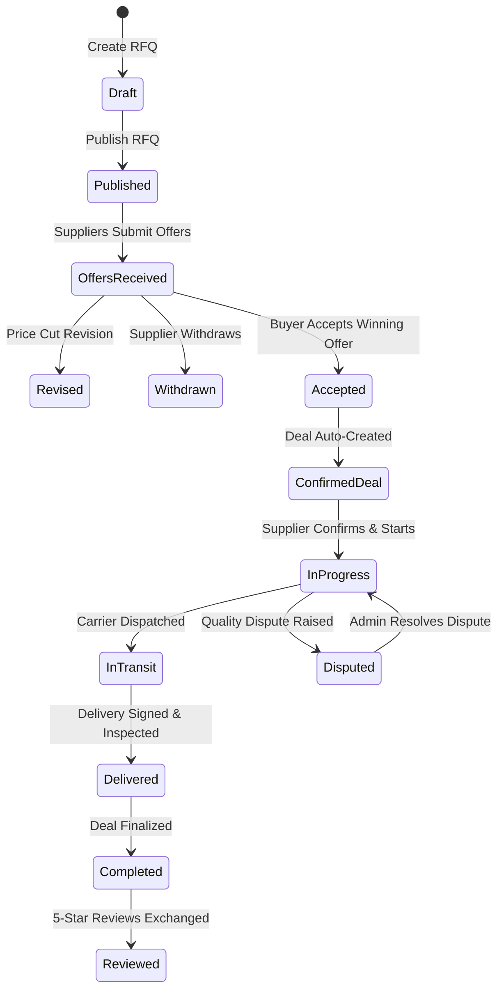

# DealZone — Comprehensive Demo Data Coverage Matrix

> **Platform Invariant:** DealZone operates strictly across three official industrial sectors:
> 1. **Metals & Steel (معادن وصلب)**
> 2. **Textiles & Yarns (منسوجات وغزول)**
> 3. **Food Processing & Commodities (أغذية وسلع تموينية)**

---

## 1. Entity Record Summary

| Entity Type | Count | Status Distribution & Scenarios |
| :--- | :---: | :--- |
| **Companies** | **10** | 4 Buyers, 4 Suppliers, 1 Dual Enterprise, 1 Fresh Buyer (0 transactions), 1 Pending, 1 UnderReview, 1 Rejected |
| **Users** | **12** | 1 System Admin, 4 Buyer Leads & Procurement Officers, 4 Suppliers, 1 Dual User, 1 Pending User, 1 Rejected User |
| **Material Categories** | **3** | `METALS`, `TEXTILES`, `FOOD` (All other legacy categories deactivated) |
| **Raw Materials** | **8** | 2 Metals (Rebar, Billet), 3 Textiles (Giza Cotton, Yarn Ne 30/1, PSF), 3 Food (Sugar ICUMSA 45, Refined, Palm Olein) |
| **Catalog Products** | **9** | 3 Metals, 3 Textiles, 3 Food (Varied inventory: In-Stock, Low Stock, Out-of-Stock) |
| **RFQs** | **6** | 1 Competing Offers, 1 Standard Published, 1 Expiring Soon, 1 Draft, 1 Closed, 1 Cancelled |
| **Offers** | **7** | 1 Accepted, 2 Competing, 2 Revisions (R1 & R2), 1 Rejected, 1 Withdrawn |
| **Tenders** | **5** | 1 Live Reverse Bidding, 1 Awarded, 1 Closed Evaluating, 1 Cancelled, 1 NoAward |
| **Tender Bids** | **5** | 1 Winning Bid, 2 Competing Bids, 1 Revised Leader Bid, 1 Withdrawn Bid |
| **Deals** | **7** | 1 from Tender Award, 5 from RFQs, 1 from Direct Catalog Purchase |
| **Direct Purchases** | **1** | Instant purchasing with inventory decrement |
| **Shipping Providers** | **3** | Al-Nile Freight, Misr Logistics, Alex Cargo Express |
| **Shipments** | **4** | 1 Assigned, 1 In-Transit with checkpoints, 1 Delivered, 1 Delayed with exception note |
| **Deal Disputes** | **2** | 1 Open Under Review, 1 Historical Resolved (Resume Deal) |
| **Reviews & Ratings** | **2** | 1 Five-Star Review, 1 Four-Star Review with verified industrial commentary |
| **Notifications** | **13** | RFP published, Offer received, Bid accepted, Shipment updated, Dispute opened |

---

## 2. Seeded Companies Detail

| Company Name | Type | City / Gov | Verification | Highlights |
| :--- | :--- | :--- | :--- | :--- |
| `[Sample] المصرية للصناعات الهندسية` | Buyer | العاشر من رمضان، الشرقية | Approved | Heavy metal manufacturer; 2 active RFQs |
| `[Sample] مصر للحلويات والأغذية الصناعية` | Buyer | السادس من أكتوبر، الجيزة | Approved | Food processing; Direct catalog buyer |
| `[Sample] الفتح للمشغولات وتشكيل المعادن` | Buyer | حلوان، القاهرة | Approved | Fresh onboarding state (0 transactions) |
| `[Sample] الأهرام لتوريدات الصلب` | Supplier | السادس من أكتوبر، الجيزة | Approved | Top metals distributor; Leader in reverse auction |
| `[Sample] المحلة للغزول والمنسوجات الحديثة` | Supplier | المحلة الكبرى، الغربية | Approved | Winner of major cotton yarn tender |
| `[Sample] الدلتا لتجارة وتكرير السكر` | Supplier | مدينة السادات، المنوفية | Approved | Refined sugar supplier; direct order fulfillment |
| `[Sample] الإسكندرية للتجارة والتصنيع المشترك` | Both | برج العرب، الإسكندرية | Approved | Operates as both Buyer and Supplier |
| `[Sample] النيل للنسيج وتجهيز الأقمشة` | Supplier | قليوب، القليوبية | Under Review | 3 uploaded PDF credentials awaiting verification |
| `[Sample] الصعيد لصهر ودرفلة المعادن` | Supplier | بني سويف | Pending | Registered account with unverified banner |
| `[Sample] مؤسسة الأمل التجارية للتوريدات` | Supplier | بورسعيد | Rejected | Explicit administrative rejection reason logged |

---

## 3. Seeded Workflow State Machine Coverage

---

## 4. Reverse Bidding Auction Lineage (TND-2026-00201)

- **Reference Price (Opening Cap):** 7,500,000 EGP
- **Bid A (Original - R1):** 7,350,000 EGP (Al-Ahram Steel)
- **Bid B (Competing):** 7,250,000 EGP (Alexandria Dual) — *Took lead*
- **Bid A (Revision - R2):** 7,100,000 EGP (Al-Ahram Steel) — *Retook lead with 150k price reduction & 5-day delivery*
- **Bid C (Withdrawn):** 7,500,000 EGP (Mahalla Textiles) — *Withdrawn with audit explanation*

