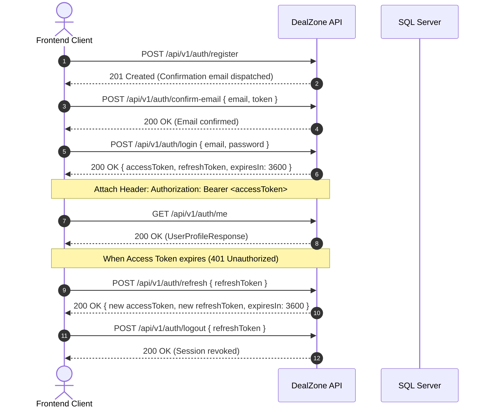
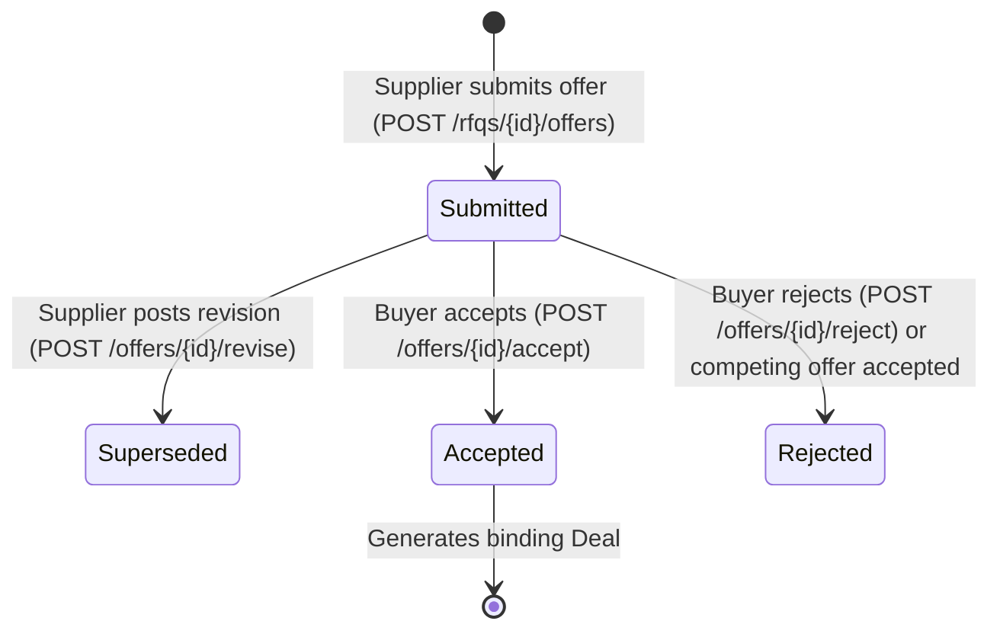

# DealZone — Frontend Developer API Handover Guide

> **Target Audience:** Frontend Developers integrating web or mobile clients with the DealZone Backend API.  
> **Backend Version:** .NET 10 / ASP.NET Core Web API (Phases 0–9 Complete)  
> **Architecture:** Clean Architecture Modular Monolith  
> **Last Verified:** 2026-10-30  

---

## Table of Contents

1. [Project Overview & Business Rules](#1-project-overview--business-rules)
2. [API Connection & Environment Setup](#2-api-connection--environment-setup)
3. [Authentication & Session Flow](#3-authentication--session-flow)
4. [Company Management & Verification](#4-company-management--verification)
5. [Raw Material Catalog](#5-raw-material-catalog)
6. [RFQ (Request for Quotation) Workflow](#6-rfq-request-for-quotation-workflow)
7. [Offers & Negotiation Lifecycle](#7-offers--negotiation-lifecycle)
8. [Deals, Fulfillment & Disputes](#8-deals-fulfillment--disputes)
9. [Shipping & Logistics](#9-shipping--logistics)
10. [Reputation & Reviews](#10-reputation--reviews)
11. [In-App Notifications](#11-in-app-notifications)
12. [Complete API Contract Reference](#12-complete-api-contract-reference)
13. [Standardized Error Handling](#13-standardized-error-handling)
14. [Frontend Integration Best Practices](#14-frontend-integration-best-practices)
15. [Important Scope Limitations](#15-important-scope-limitations)

---

## 1. Project Overview & Business Rules

### What DealZone Does
DealZone is an Egyptian B2B marketplace platform for industrial raw materials (chemicals, metals, polymers, packaging, minerals, etc.). It connects corporate **Buyers** looking to procure bulk raw materials with verified corporate **Suppliers** through structured Request for Quotation (RFQ) bidding, immutable offer negotiations, binding commercial deals, logistics tracking, and verified company reviews.

### Identity Model & Roles
- **User:** An individual person identified by email and credentials. A user can belong to a Company.
- **SystemAdmin:** A platform administrator with platform-wide governance rights (verifying companies, managing the catalog, arbitrating disputes, managing shipping providers). Defined by `isSystemAdmin: true` and the `"SystemAdmin"` policy.
- **Company:** A legal corporate entity registered with tax and commercial registration numbers.
- **Company Roles:**
  - `Owner` (`1`): Creator or primary head of the company. Has full authority over company profile, member management, verification documents, and all commercial operations (buyer and supplier workflows).
  - `Admin` (`2`): Administrative officer. Can update company profile, upload/delete verification documents, submit for review, and execute commercial actions.
  - `ProcurementManager` (`3`): Authorized for **Buyer** operations: create, update, publish, close, and cancel RFQs; evaluate, accept, and reject incoming offers; confirm, complete, and request cancellation for deals on the buyer side; open disputes; and submit post-deal reviews. Cannot update company profile, upload/delete verification documents, submit supplier offers, or manage shipments.
  - `SalesManager` (`4`): Authorized for **Supplier** operations: browse published RFQs, submit and revise structured offers; confirm, start, complete, and request cancellation for deals on the supplier side; open disputes; create and update shipments; and submit post-deal reviews. Cannot update company profile, upload/delete verification documents, or accept/reject offers on behalf of buyers.
  - `Member` (`5`): Read-only company member. Can query company profile, view RFQs/offers/deals/shipments/disputes/reviews where their company is a participant, and receive user-level notifications. Cannot execute mutations (creates, updates, status transitions, or submissions).

### Core Business Restrictions
1. **Commercial Activities Require Verification:** New companies start in `Pending` verification status (`VerificationStatus = 0`). Until an admin reviews and approves the company (`Approved = 2`), company members **cannot** create RFQs, discover published RFQs, submit offers, or enter into commercial deals.
2. **Strict Multi-Tenant Isolation:** All company data queries and mutations are server-enforced using the authenticated token's company membership (`ICurrentUser.CompanyId`). Clients cannot pass arbitrary `companyId` parameters to view or mutate other companies' commercial data.
3. **Contact Details Privacy:** Corporate tax registration and private contact information (`CompanyContactDetails`) are strictly isolated behind a dedicated authenticated endpoint (`/api/v1/companies/me/contact-details`) and are **never** returned in public marketplace queries or discovery feeds.

---

## 2. API Connection & Environment Setup

### Readiness Status
- **Backend API Implementation:** 100% complete across Phases 0–9 and **Ready for Frontend Integration**.
- **Public Production Deployment:** Not yet cleared until mandatory pre-production infrastructure (production secrets, SMTP credentials, SSL termination, and rate limiting) is configured.

### Connection URLs
Based on the actual project configuration in `Properties/launchSettings.json`:

| Environment | Base URL | Swagger UI | OpenAPI JSON | Notes |
|---|---|---|---|---|
| **Local (HTTP)** | `http://localhost:5023` | `http://localhost:5023/swagger` | `http://localhost:5023/openapi/v1.json` | Default HTTP profile |
| **Local (HTTPS)** | `https://localhost:7192` | `https://localhost:7192/swagger` | `https://localhost:7192/openapi/v1.json` | Default HTTPS profile |

All operational API endpoints are prefixed with:  
`/api/v1/`

### Running the Backend Locally

#### 1. Prerequisites:
- .NET 10 SDK installed (`dotnet --version` should return `10.0.x`).
- Microsoft SQL Server running locally with `Trusted_Connection=True` (or update `ConnectionStrings:DefaultConnection` in `appsettings.Development.json`).

#### 2. Database Update:
- **PowerShell:**
  ```powershell
  dotnet ef database update --project src/DealZone.Infrastructure --startup-project src/DealZone.Api
  ```
- **Windows Command Prompt (CMD):**
  ```cmd
  dotnet ef database update --project src/DealZone.Infrastructure --startup-project src/DealZone.Api
  ```

#### 3. Run the API:
- **PowerShell:**
  ```powershell
  dotnet run --project src/DealZone.Api
  ```
- **Windows Command Prompt (CMD):**
  ```cmd
  dotnet run --project src/DealZone.Api
  ```

#### 4. CORS:
`appsettings.Development.json` permits requests from common frontend dev servers:
- `http://localhost:3000`
- `http://localhost:5173`

---

## 3. Authentication & Session Flow

DealZone uses stateless JWT (JSON Web Tokens) access tokens accompanied by cryptographically random refresh tokens stored as SHA-256 hashes in the database.



### 1. Register User
- **Route:** `POST /api/v1/auth/register`
- **Request Body:**
  ```json
  {
    "email": "procurement@egyptsteel.com",
    "password": "StrongPassword123!",
    "fullName": "Ahmed Mansour",
    "phoneNumber": "+201012345678"
  }
  ```
- **Response (201 Created):**
  ```json
  {
    "userId": "3fa85f64-5717-4562-b3fc-2c963f66afa6",
    "email": "procurement@egyptsteel.com",
    "message": "Registration successful. Please verify your email before logging in."
  }
  ```

### 2. Confirm Email
- **Route:** `POST /api/v1/auth/confirm-email`
- **Request Body:**
  ```json
  {
    "email": "procurement@egyptsteel.com",
    "token": "raw_confirmation_token_received_via_email"
  }
  ```
- **Response (200 OK):**
  ```json
  {
    "message": "Email confirmed successfully. You can now log in."
  }
  ```

### 3. Login
- **Route:** `POST /api/v1/auth/login`
- **Request Body:**
  ```json
  {
    "email": "procurement@egyptsteel.com",
    "password": "StrongPassword123!"
  }
  ```
- **Response (200 OK):**
  ```json
  {
    "accessToken": "eyJhbGciOiJIUzI1NiIsInR5cCI6...",
    "refreshToken": "4a7f29f0e34c4f348e8e7b99...",
    "expiresIn": 3600,
    "tokenType": "Bearer"
  }
  ```

### 4. Refresh Token
- **Route:** `POST /api/v1/auth/refresh`
- **Request Body:**
  ```json
  {
    "refreshToken": "4a7f29f0e34c4f348e8e7b99..."
  }
  ```
- **Response (200 OK):**
  Returns a **newly rotated** token pair. The old refresh token is revoked.
  ```json
  {
    "accessToken": "eyJhbGciOiJIUzI1NiIsInR5cCI6...",
    "refreshToken": "8b9e11a2f45c4d219a1b2c3d...",
    "expiresIn": 3600,
    "tokenType": "Bearer"
  }
  ```
- **Important:** If a revoked refresh token is presented (replay attack), the backend revokes the entire token family, forcing a clean login.

### 5. Logout
- **Route:** `POST /api/v1/auth/logout`
- **Request Body:**
  ```json
  {
    "refreshToken": "8b9e11a2f45c4d219a1b2c3d..."
  }
  ```
- **Response (200 OK):**
  ```json
  {
    "message": "Logged out successfully."
  }
  ```

### 6. Get Current User Profile
- **Route:** `GET /api/v1/auth/me`
- **Headers:** `Authorization: Bearer <accessToken>`
- **Response (200 OK):**
  ```json
  {
    "id": "3fa85f64-5717-4562-b3fc-2c963f66afa6",
    "email": "procurement@egyptsteel.com",
    "fullName": "Ahmed Mansour",
    "phoneNumber": "+201012345678",
    "isEmailConfirmed": true,
    "isSystemAdmin": false,
    "company": {
      "id": "e4f808aa-4623-448c-bf34-f6b0f0a4249a",
      "legalName": "Egyptian Steel Industries S.A.E.",
      "tradeName": "Egypt Steel",
      "industrySector": "Metals & Metallurgy",
      "city": "6th of October",
      "governorate": "Giza",
      "verificationStatus": "Approved",
      "canPerformCommercialActivities": true,
      "role": "Owner"
    }
  }
  ```
  *(Note: If the user has not yet registered a company, `company` will be `null`.)*

### Token & Authorization Rules
- **Access Token Lifetime:** 60 minutes (`expiresIn: 3600`).
- **Refresh Token Lifetime:** 30 days.
- **Header:** Include `Authorization: Bearer <accessToken>` on all protected calls.
- **Handling 401 Unauthorized:** Intercept 401 responses, call `/api/v1/auth/refresh` once. If refresh succeeds, replay original request. If refresh fails (or returns 401/400), clear stored tokens and redirect to login.
- **Handling 403 Forbidden:** The user is authenticated, but lacks permissions (e.g., non-admin calling an admin route, or unapproved company attempting commercial actions). Do **not** redirect to login; show an access denied or verification pending prompt.

---

## 4. Company Management & Verification

### Company Verification Lifecycle
```
[No Company] 
    ↓ (POST /api/v1/companies)
Pending (VerificationStatus = 0)
    ↓ (Upload Documents & POST /api/v1/companies/me/verification/submit)
UnderReview (VerificationStatus = 1)
    ↙                                     ↘
Approved (2)                       ChangesRequired (5)      →  Rejected (3)
[Commercial Access Enabled]       [Upload Fixes & Resubmit]     [Terminal]
```

### 1. Register Company
- **Route:** `POST /api/v1/companies`
- **Headers:** `Authorization: Bearer <accessToken>`
- **Request Body:**
  ```json
  {
    "legalName": "Egyptian Steel Industries S.A.E.",
    "tradeName": "Egypt Steel",
    "industrySector": "Metals & Metallurgy",
    "city": "6th of October",
    "governorate": "Giza",
    "description": "Leading manufacturer of steel rebar and wire rod.",
    "website": "https://egyptsteel.example.com",
    "taxIdNumber": "123-456-789",
    "commercialRegistrationNumber": "987654",
    "corporateEmail": "info@egyptsteel.com",
    "corporatePhone": "+20238123456",
    "addressLine1": "Industrial Zone 4, Plot 12",
    "addressLine2": null,
    "postalCode": "12566"
  }
  ```
- **Response (201 Created):** Returns `CompanyResponse`. The creator user is automatically assigned as company `Owner`.

### 2. View and Update Company Profile
- `GET /api/v1/companies/me`: Returns public profile (`CompanyResponse`).
- `PUT /api/v1/companies/me`: Updates public fields (`tradeName`, `city`, `governorate`, `description`, `website`). Restricted to `Owner` or `Admin`.
- `GET /api/v1/companies/me/contact-details`: Returns private legal/tax information (`CompanyContactDetailsResponse`). Only accessible by verified members of the owning company.

### 3. Upload Verification Documents
- **Route:** `POST /api/v1/companies/me/verification-documents`
- **Content-Type:** `multipart/form-data`
- **Form Fields:**
  - `documentType` (integer):
    - `1` = `CommercialRegister` *(Mandatory)*
    - `2` = `TaxCard` *(Mandatory)*
    - `3` = `IndustrialRegister`
    - `4` = `QualityCertificate`
    - `5` = `Other`
  - `file`: Binary file (PDF, JPEG, or PNG; maximum 10 MB).
- **Validation:** Server verifies file size, extension whitelist, and binary magic bytes.
- **Response (201 Created):** Returns `UploadDocumentResponse`.

### 4. Verification Status & Submission
- `GET /api/v1/companies/me/verification`: Returns current verification state and list of uploaded documents.
- `DELETE /api/v1/companies/me/verification-documents/{documentId}`: Deletes an uploaded document (only allowed while status is `Pending` or `ChangesRequired`).
- `POST /api/v1/companies/me/verification/submit`: Submits the company for admin review. Both `CommercialRegister` and `TaxCard` must be uploaded. Changes status to `UnderReview`.

---

## 5. Raw Material Catalog

Catalog endpoints provide the hierarchical taxonomy of industrial materials. All `/api/v1/catalog/*` endpoints are **public** and do not require authentication.

### 1. Categories Hierarchy
- **Route:** `GET /api/v1/catalog/categories`
- **Response (200 OK):** Returns a hierarchical tree of raw material categories with bilingual Arabic/English names:
  ```json
  [
    {
      "id": "11111111-1111-1111-1111-111111111111",
      "parentCategoryId": null,
      "code": "METALS",
      "nameAr": "المعادن والصلب",
      "nameEn": "Metals & Steel",
      "descriptionAr": "منتجات الصلب والمعادن الصناعية",
      "descriptionEn": "Industrial steel and metal products",
      "displayOrder": 1,
      "isActive": true,
      "isArchived": false,
      "subCategories": [
        {
          "id": "11111111-1111-1111-1111-222222222222",
          "parentCategoryId": "11111111-1111-1111-1111-111111111111",
          "code": "FERROUS",
          "nameAr": "المعادن الحديدية",
          "nameEn": "Ferrous Metals",
          "displayOrder": 1,
          "isActive": true,
          "isArchived": false,
          "subCategories": []
        }
      ]
    }
  ]
  ```

### 2. Search & Paginate Materials
- **Route:** `GET /api/v1/catalog/materials`
- **Query Parameters:**
  - `categoryId` (Guid, optional): Filter by category.
  - `searchTerm` (string, optional): Search by code or English/Arabic name.
  - `activeOnly` (bool, default `true`): Include only active items.
  - `pageNumber` (int, default `1`).
  - `pageSize` (int, default `20`).
  - `sortBy` (string, optional: `"name"`, `"code"`, `"created"`).
  - `sortDescending` (bool, default `false`).
- **Response (200 OK):** Returns `PagedResult<MaterialDto>`.

### 3. Units of Measure
- **Route:** `GET /api/v1/catalog/units`
- Returns standard industrial units: `MetricTon` (طن متري / MT), `Kilogram` (كجم / kg), `Liter` (لتر / L), `CubicMeter` (متر مكعب / m³), `Piece` (قطعة / pc), etc.

---

## 6. RFQ (Request for Quotation) Workflow

The buyer RFQ lifecycle follows:
```
Draft (0) ──[Publish]──> Published (1) ──[Close]──> Closed (2)
   │                           │
   └─────────[Cancel]──────────┴──────────────────> Cancelled (3)
```

### 1. Create RFQ
- **Route:** `POST /api/v1/rfqs`
- **Headers:** `Authorization: Bearer <accessToken>`
- **Prerequisite:** Authenticated user must belong to an `Approved` company.
- **Request Body:**
  ```json
  {
    "title": "Procurement of High-Grade Steel Billets 150x150mm",
    "description": "Quarterly procurement for factory line expansion in Sadat City.",
    "targetCategoryId": "11111111-1111-1111-1111-222222222222",
    "deliveryGovernorate": "Monufia",
    "deliveryCity": "Sadat City",
    "deliveryAddress": "Industrial Zone 2, Plot 45",
    "closingDateUtc": "2026-12-01T18:00:00Z",
    "requiredDeliveryDateUtc": "2026-12-15T00:00:00Z",
    "targetBudget": 2500000.00,
    "currency": "EGP",
    "notes": "Testing certifications required upon delivery.",
    "publishImmediately": true,
    "items": [
      {
        "categoryId": "11111111-1111-1111-1111-222222222222",
        "materialId": "22222222-2222-2222-2222-222222222222",
        "materialName": "Steel Billets 150x150mm Grade 3SP/5SP",
        "specifications": "Standard 150x150mm cross section, length 6m-12m.",
        "quantity": 250.0000,
        "unitOfMeasureId": "33333333-3333-3333-3333-333333333333",
        "targetPricePerUnit": 10000.00,
        "notes": "Must comply with ASTM A615 standards"
      }
    ]
  }
  ```
- **Response (201 Created):** Returns `RfqDetailResponse`.

### 2. Discovering Open RFQs (Supplier View)
- **Route:** `GET /api/v1/rfqs`
- **Access:** Only approved suppliers can browse the marketplace feed.
- **Query Parameters:** `categoryId`, `materialId`, `governorate`, `city`, `searchTerm`, `closingBeforeUtc`, `pageNumber`, `pageSize`, `sortBy`, `sortDescending`.
- **Privacy Enforcement:** Sanitizes buyer private contact info. Returns only `buyerCompanyName`, `buyerGovernorate`, and `buyerCity`.

### 3. Managing Own RFQs (Buyer View)
- `GET /api/v1/rfqs/mine`: Paginated list of all RFQs created by the caller's company (supports `status` filter: `"Draft"`, `"Published"`, `"Closed"`, `"Cancelled"`).
- `GET /api/v1/rfqs/{id}`: Detailed RFQ response including all line items.
- `PUT /api/v1/rfqs/{id}`: Update an RFQ (full item edits allowed while in `Draft`; only delivery details/notes when `Published`).
- `POST /api/v1/rfqs/{id}/publish`: Moves `Draft` to `Published`.
- `POST /api/v1/rfqs/{id}/close`: Closes RFQ from receiving any more offers.
- `POST /api/v1/rfqs/{id}/cancel`: Cancels the RFQ.

---

## 7. Offers & Negotiation Lifecycle

Suppliers bid on published RFQs. Offer terms support revision tracking with immutable historical lineage.

### Implemented Offer State Machine


> **Enum vs. Implemented Behavior Note:** The domain enum `OfferStatus` defines additional values (`UnderReview = 1`, `Withdrawn = 5`, `Expired = 6`) for future roadmap releases. However, in the current backend implementation (Phases 0–9), there are **no endpoints or automated jobs** that transition offers into `UnderReview`, `Withdrawn`, or `Expired`. Active offers reside in `Submitted`, transitioning to `Superseded` on revision, `Accepted` on buyer acceptance, or `Rejected` on explicit or competing buyer rejection.

### 1. Submit Initial Offer (Supplier)
- **Route:** `POST /api/v1/rfqs/{rfqId}/offers`
- **Headers:** `Authorization: Bearer <accessToken>`
- **Authorization:** Authenticated user from an `Approved` supplier company with role `Owner`, `Admin`, or `SalesManager`.
- **Request Body:**
  ```json
  {
    "deliveryLeadTimeDays": 14,
    "shippingIncluded": true,
    "paymentTerms": "30% advance, 70% against delivery documents",
    "validityDateUtc": "2026-11-20T23:59:59Z",
    "currency": "EGP",
    "notes": "Price includes delivery to Sadat City.",
    "items": [
      {
        "rfqItemId": "aaaaaaaa-aaaa-aaaa-aaaa-aaaaaaaaaaaa",
        "unitPrice": 9800.00,
        "offeredQuantity": 250.0000,
        "materialSpecifications": "Conforms to 5SP standard",
        "notes": "Origin: Egypt"
      }
    ]
  }
  ```
- **Response (201 Created):** Returns `OfferDetailResponse` with `revisionNumber: 1` and `status: "Submitted"`.

### 2. Revise Offer (Supplier)
- **Route:** `POST /api/v1/offers/{id}/revise`
- **Authorization:** `Owner`, `Admin`, or `SalesManager` of the offering supplier company.
- When prices or lead times are renegotiated, the supplier submits a revision. The previous offer becomes `Superseded`, and a new linked offer is created with `revisionNumber = previous + 1`.
- **Request Body:** Same shape as `CreateOfferRequest` plus `"changeSummary": "Reduced unit price by 300 EGP per ton"`.
- View history: `GET /api/v1/offers/{id}/revisions` returns the full revision tree.

### 3. Accept Offer (Buyer Decision)
- **Route:** `POST /api/v1/offers/{id}/accept`
- **Restricted To:** Owning buyer (`Owner`, `Admin`, or `ProcurementManager`).
- **Atomic Operations Performed by Backend:**
  1. Sets selected offer status to `Accepted`.
  2. Creates a binding commercial `Deal` record with immutable snapshot terms.
  3. Automatically marks all competing active offers (`Submitted`) for that RFQ as `Rejected`.
  4. Automatically closes the parent RFQ (`Closed`).
  5. Dispatches notifications to the accepted supplier and competing bidders.
- **Concurrency Protection:** A database filtered unique index (`IX_Offers_RfqId_Accepted`) prevents double-acceptance races. If another user accepts an offer simultaneously, the backend returns **409 Conflict**.

### 4. Reject Offer
- **Route:** `POST /api/v1/offers/{id}/reject`
- **Restricted To:** Owning buyer (`Owner`, `Admin`, or `ProcurementManager`).
- **Request Body:** `{ "reason": "Price exceeds approved target budget." }`

---

## 8. Deals, Fulfillment & Disputes

A deal is generated when an offer is accepted.

### Deal State Machine
```
[Offer Accepted] 
       ↓
AwaitingConfirmation (0) 
       ↓ (Both Buyer & Supplier confirm: POST /deals/{id}/confirm)
   Confirmed (1)
       ↓ (Supplier starts work: POST /deals/{id}/start)
   InProgress (2) 
       ↓ (Fulfillment finished: POST /deals/{id}/complete)
   Completed (3) ──> [Enables Post-Deal Reviews]
```
*(At any stage prior to completion, parties may request cancellation or open a dispute, moving the deal to `Disputed` (3) or `Cancelled` (5).)*

### 1. Confirm Deal
- **Route:** `POST /api/v1/deals/{id}/confirm`
- Both parties must independently confirm:
  - Buyer confirmation requires role: `Owner`, `Admin`, or `ProcurementManager`.
  - Supplier confirmation requires role: `Owner`, `Admin`, or `SalesManager`.
- The deal stays in `AwaitingConfirmation` with flags `confirmedByBuyer` and `confirmedBySupplier`. Once both are `true`, the status automatically advances to `Confirmed`.

### 2. Start and Complete Deal
- `POST /api/v1/deals/{id}/start`: Supplier indicates production/dispatch has started. Status -> `InProgress`. Accessible only to supplier (`Owner`, `Admin`, or `SalesManager`).
- `POST /api/v1/deals/{id}/complete`: Marks deal fulfilled. Status -> `Completed`. Accessible to either participant (`Owner`, `Admin`, `ProcurementManager` for buyer; `Owner`, `Admin`, `SalesManager` for supplier). Once completed, both companies may review each other.

### 3. Deal Cancellation Workflow
- **Route:** `POST /api/v1/deals/{id}/cancel`
- **Request Body:**
  ```json
  {
    "reason": "Mutual agreement due to raw material import stoppage."
  }
  ```
- **Lifecycle & Operational Rules:**
  1. **While in `AwaitingConfirmation`:**
     - Either participant can cancel unilaterally. Calling `POST /api/v1/deals/{id}/cancel` immediately transitions the deal to `Cancelled` (`Status = 5`).
  2. **While in `Confirmed` or `InProgress`:**
     - **Initiating Party:** When the first party calls `POST /api/v1/deals/{id}/cancel`, the backend records `cancellationRequestedByCompanyId`, `cancellationRequestedAtUtc`, and `cancellationRequestReason`. The deal remains in its current status (`Confirmed` or `InProgress`).
     - **Re-calling by Initiator:** If the initiating party calls `/cancel` again while pending, the API returns **409 Conflict** (`"A cancellation request is already pending review by the counterparty."`).
     - **Counterparty Action (Consent):** The counterparty agrees to cancellation by calling the **exact same endpoint** `POST /api/v1/deals/{id}/cancel` with their confirmation reason. Because the request originates from the other company, the backend recognizes mutual consent, terminates the deal, and transitions status to `Cancelled`.
     - **No Rejection Endpoint:** There is **no dedicated reject-cancellation endpoint**. If the counterparty disagrees with cancellation, they simply do not submit a cancellation call. They can proceed with deal execution (e.g. fulfill or update shipment) or, in the case of irreconcilable disagreement, escalate by opening a formal dispute (`POST /api/v1/deals/{id}/disputes`).

### 4. Disputes & Admin Resolution
- **Open Dispute:** `POST /api/v1/deals/{id}/disputes`
  - Accessible to either deal participant (`Owner`, `Admin`, `ProcurementManager` for buyer; `Owner`, `Admin`, `SalesManager` for supplier).
  - Categories: `QualityDefect` (`1`), `QuantityMismatch` (`2`), `LateDelivery` (`3`), `DamagedGoods` (`4`), `NonDelivery` (`5`), `TermsViolation` (`6`), `Other` (`99`).
  - Sets deal status to `Disputed`.
- **Admin Resolve Dispute:** `POST /api/v1/admin/disputes/{id}/resolve`
  - Restricted to `SystemAdmin`.
  - Action: `ResumeDeal` (`1`) restores deal to its pre-dispute state (checks confirmation timestamps to resume as `Confirmed` or `AwaitingConfirmation`); `CancelDeal` (`2`) terminates the deal as `Cancelled`.

---

## 9. Shipping & Logistics

DealZone supports two logistics arrangements established during shipment creation:
1. **SupplierArranged (`1`):** Supplier provides carrier and tracking info; supplier updates shipment milestones.
2. **DealZoneArranged (`2`):** Platform administrator assigns an active shipping provider and manages tracking.

### Shipment Milestones (`ShipmentStatus`)
`Pending (0)` → `Assigned (1)` → `PickedUp (2)` → `InTransit (3)` → `OutForDelivery (4)` → `Delivered (5)` (or `Failed (6)`, `Cancelled (7)`).

> **Important Business Rule:** Setting a shipment status to `Delivered` does **not** automatically mark the parent Deal as `Completed`. Deal completion remains an explicit operational action by the deal participants.

### Shipping Endpoints
- `POST /api/v1/deals/{dealId}/shipments`: Supplier arranges shipment (`CreateShipmentRequest`).
- `GET /api/v1/deals/{dealId}/shipments`: List shipments for a deal.
- `GET /api/v1/shipments/{id}`: Detailed shipment info and full timeline of `trackingEvents`.
- `PUT /api/v1/shipments/{id}/tracking`: Update tracking number and carrier.
- `POST /api/v1/shipments/{id}/status`: Transition status (`UpdateShipmentStatusRequest`).
- `POST /api/v1/admin/shipments/{id}/assign-provider`: Admin assigns a provider for DealZone-arranged shipments.

---

## 10. Reputation & Reviews

To protect marketplace integrity, reviews are verified and post-deal only.

### Eligibility Rules
1. Deal status **must** be `Completed`.
2. Only the actual **Buyer** and **Supplier** participants can review each other.
3. Exactly **one** review per company per deal (enforced by composite unique index `IX_Reviews_DealId_ReviewerCompanyId`).

### Endpoints
- `POST /api/v1/deals/{dealId}/reviews`: Submit rating (1–5) and comment (`CreateReviewRequest`). Accessible to verified deal participants.
- `GET /api/v1/deals/{dealId}/reviews`: View reviews for a specific deal. Requires `Bearer JWT` authentication (accessible to any authenticated platform user).
- `GET /api/v1/companies/{companyId}/reviews`: Public anonymous endpoint returning company reputation metrics (`averageRating`, `totalReviews`, and paginated list of reviews).
- `GET /api/v1/companies/me/reviews`: Reviews received by the caller's company. Requires `Bearer JWT` authentication.

---

## 11. In-App Notifications

Notifications belong to individual **users** (not companies). They notify users of important events across verification, RFQs, offers, deals, shipments, and reviews.

### Endpoints
- `GET /api/v1/notifications`: Paginated list of notifications. Supports `isRead` query filter (`true`, `false`, or omitted for all).
- `GET /api/v1/notifications/unread-count`: Returns `{ "unreadCount": 5 }` for badge counters.
- `POST /api/v1/notifications/{id}/read`: Mark a single notification as read.
- `POST /api/v1/notifications/read-all`: Mark all notifications as read. Returns `{ "markedAsReadCount": 5 }`.

### Notification Response Structure
```json
{
  "id": "7fa85f64-5717-4562-b3fc-2c963f66af99",
  "userId": "3fa85f64-5717-4562-b3fc-2c963f66afa6",
  "type": "OfferAccepted",
  "title": "Offer Accepted",
  "message": "Your offer for RFQ RFQ-2026-00001 has been accepted! Deal DEAL-2026-00001 created.",
  "relatedEntityType": "Deal",
  "relatedEntityId": "4ba85f64-5717-4562-b3fc-2c963f66af22",
  "isRead": false,
  "readAtUtc": null,
  "createdAtUtc": "2026-10-30T18:45:00Z"
}
```

---

## 12. Complete API Contract Reference

The following table documents all **80 distinct controller action operations** (mapped to 82 HTTP routes due to 2 legacy route aliases on `VerificationController`) and **4 system/OpenAPI endpoints**, for a total of **84 documented operations** (86 mapped HTTP method + route combinations) verified directly against controller source code:

| Method | Exact Route | Tag / Domain | Auth Required | Required Roles / Policy | Key Params / Body | Status Code |
|---|---|---|---|---|---|---|
| `POST` | `/api/v1/auth/register` | Authentication | Anonymous | None | `RegisterRequest` | 201 Created |
| `POST` | `/api/v1/auth/login` | Authentication | Anonymous | None | `LoginRequest` | 200 OK |
| `POST` | `/api/v1/auth/refresh` | Authentication | Anonymous | None | `RefreshTokenRequest` | 200 OK |
| `POST` | `/api/v1/auth/logout` | Authentication | Anonymous | None | `RefreshTokenRequest?` | 200 OK |
| `POST` | `/api/v1/auth/confirm-email` | Authentication | Anonymous | None | `ConfirmEmailRequest` | 200 OK |
| `POST` | `/api/v1/auth/resend-confirmation` | Authentication | Anonymous | None | `ResendConfirmationRequest`| 200 OK |
| `POST` | `/api/v1/auth/forgot-password` | Authentication | Anonymous | None | `ForgotPasswordRequest` | 200 OK |
| `POST` | `/api/v1/auth/reset-password` | Authentication | Anonymous | None | `ResetPasswordRequest` | 200 OK |
| `GET` | `/api/v1/auth/me` | Authentication | Bearer JWT | Authenticated User | None | 200 OK |
| `POST` | `/api/v1/companies` | Companies | Bearer JWT | Authenticated User | `CreateCompanyRequest` | 201 Created |
| `GET` | `/api/v1/companies/me` | Companies | Bearer JWT | Company Member | None | 200 OK |
| `PUT` | `/api/v1/companies/me` | Companies | Bearer JWT | Owner, Admin | `UpdateCompanyProfileRequest` | 200 OK |
| `GET` | `/api/v1/companies/me/contact-details`| Companies | Bearer JWT | Company Member | None | 200 OK |
| `POST` | `/api/v1/companies/me/verification-documents` *(alias: `/verification/documents`)*| Verification | Bearer JWT | Owner, Admin | `multipart/form-data` | 201 Created |
| `GET` | `/api/v1/companies/me/verification` | Verification | Bearer JWT | Company Member | None | 200 OK |
| `DELETE`| `/api/v1/companies/me/verification-documents/{documentId}` *(alias: `/verification/documents/{documentId}`)*| Verification | Bearer JWT | Owner, Admin | `documentId: Guid` | 204 No Content |
| `POST` | `/api/v1/companies/me/verification/submit`| Verification | Bearer JWT | Owner, Admin | None | 204 No Content |
| `GET` | `/api/v1/admin/verification/pending`| Admin | Bearer JWT | SystemAdmin | None | 200 OK |
| `GET` | `/api/v1/admin/verification/{companyId}`| Admin | Bearer JWT | SystemAdmin | `companyId: Guid` | 200 OK |
| `POST` | `/api/v1/admin/verification/{companyId}/approve`| Admin | Bearer JWT | SystemAdmin | `companyId: Guid` | 204 No Content |
| `POST` | `/api/v1/admin/verification/{companyId}/reject`| Admin | Bearer JWT | SystemAdmin | `RejectCompanyRequest` | 204 No Content |
| `POST` | `/api/v1/admin/verification/{companyId}/request-changes`| Admin | Bearer JWT | SystemAdmin | `RequestChangesRequest`| 204 No Content |
| `GET` | `/api/v1/admin/verification/{companyId}/documents/{documentId}/download`| Admin | Bearer JWT | SystemAdmin | `companyId`, `documentId`| 200 (File Stream) |
| `POST` | `/api/v1/admin/catalog/categories` | Admin Catalog | Bearer JWT | SystemAdmin | `CreateCategoryRequest`| 201 Created |
| `PUT` | `/api/v1/admin/catalog/categories/{id}`| Admin Catalog | Bearer JWT | SystemAdmin | `UpdateCategoryRequest`| 200 OK |
| `DELETE`| `/api/v1/admin/catalog/categories/{id}`| Admin Catalog | Bearer JWT | SystemAdmin | `id: Guid` | 204 No Content |
| `POST` | `/api/v1/admin/catalog/materials` | Admin Catalog | Bearer JWT | SystemAdmin | `CreateMaterialRequest`| 201 Created |
| `PUT` | `/api/v1/admin/catalog/materials/{id}` | Admin Catalog | Bearer JWT | SystemAdmin | `UpdateMaterialRequest`| 200 OK |
| `DELETE`| `/api/v1/admin/catalog/materials/{id}` | Admin Catalog | Bearer JWT | SystemAdmin | `id: Guid` | 204 No Content |
| `POST` | `/api/v1/admin/catalog/units` | Admin Catalog | Bearer JWT | SystemAdmin | `CreateUnitRequest` | 201 Created |
| `PUT` | `/api/v1/admin/catalog/units/{id}` | Admin Catalog | Bearer JWT | SystemAdmin | `UpdateUnitRequest` | 200 OK |
| `DELETE`| `/api/v1/admin/catalog/units/{id}` | Admin Catalog | Bearer JWT | SystemAdmin | `id: Guid` | 204 No Content |
| `GET` | `/api/v1/catalog/categories` | Catalog | Anonymous | Public | None | 200 OK |
| `GET` | `/api/v1/catalog/categories/{id}` | Catalog | Anonymous | Public | `id: Guid` | 200 OK |
| `GET` | `/api/v1/catalog/materials` | Catalog | Anonymous | Public | `CatalogMaterialFilter` | 200 OK |
| `GET` | `/api/v1/catalog/materials/{id}` | Catalog | Anonymous | Public | `id: Guid` | 200 OK |
| `GET` | `/api/v1/catalog/units` | Catalog | Anonymous | Public | None | 200 OK |
| `GET` | `/api/v1/catalog/units/{id}` | Catalog | Anonymous | Public | `id: Guid` | 200 OK |
| `POST` | `/api/v1/rfqs` | RFQs | Bearer JWT | Approved Buyer (Owner, Admin, Procurement) | `CreateRfqRequest` | 201 Created |
| `GET` | `/api/v1/rfqs/{id}` | RFQs | Bearer JWT | Buyer / Supplier | `id: Guid` | 200 OK |
| `GET` | `/api/v1/rfqs/mine` | RFQs | Bearer JWT | Approved Buyer | `MyRfqFilter` | 200 OK |
| `GET` | `/api/v1/rfqs` | RFQs | Bearer JWT | Approved Supplier | `RfqDiscoveryFilter` | 200 OK |
| `PUT` | `/api/v1/rfqs/{id}` | RFQs | Bearer JWT | Owning Buyer (Owner, Admin, Procurement) | `UpdateRfqRequest` | 200 OK |
| `POST` | `/api/v1/rfqs/{id}/publish` | RFQs | Bearer JWT | Owning Buyer (Owner, Admin, Procurement) | `id: Guid` | 200 OK |
| `POST` | `/api/v1/rfqs/{id}/close` | RFQs | Bearer JWT | Owning Buyer (Owner, Admin, Procurement) | `id: Guid` | 200 OK |
| `POST` | `/api/v1/rfqs/{id}/cancel` | RFQs | Bearer JWT | Owning Buyer (Owner, Admin, Procurement) | `id: Guid` | 200 OK |
| `GET` | `/api/v1/offers/{id}` | Offers | Bearer JWT | Buyer or Supplier | `id: Guid` | 200 OK |
| `GET` | `/api/v1/offers/mine` | Offers | Bearer JWT | Approved Supplier | `OfferFilter` | 200 OK |
| `POST` | `/api/v1/offers/{id}/revise` | Offers | Bearer JWT | Owning Supplier (Owner, Admin, Sales) | `ReviseOfferRequest` | 201 Created |
| `GET` | `/api/v1/offers/{id}/revisions` | Offers | Bearer JWT | Buyer or Supplier | `id: Guid` | 200 OK |
| `POST` | `/api/v1/offers/{id}/accept` | Offers | Bearer JWT | Owning Buyer (Owner, Admin, Procurement) | `AcceptOfferRequest?` | 200 OK |
| `POST` | `/api/v1/offers/{id}/reject` | Offers | Bearer JWT | Owning Buyer (Owner, Admin, Procurement) | `RejectOfferRequest` | 200 OK |
| `POST` | `/api/v1/rfqs/{rfqId}/offers` | Offers | Bearer JWT | Approved Supplier (Owner, Admin, Sales) | `CreateOfferRequest` | 201 Created |
| `GET` | `/api/v1/rfqs/{rfqId}/offers/mine` | Offers | Bearer JWT | Approved Supplier | `rfqId: Guid` | 200 OK |
| `GET` | `/api/v1/rfqs/{rfqId}/offers` | Offers | Bearer JWT | Owning Buyer | `rfqId: Guid` | 200 OK |
| `GET` | `/api/v1/deals/mine` | Deals | Bearer JWT | Deal Participant | `DealStatus?`, paging | 200 OK |
| `GET` | `/api/v1/deals/{id}` | Deals | Bearer JWT | Deal Participant / Admin| `id: Guid` | 200 OK |
| `POST` | `/api/v1/deals/{id}/confirm` | Deals | Bearer JWT | Buyer (Procurement) or Supplier (Sales) / Owner / Admin | `id: Guid` | 200 OK |
| `POST` | `/api/v1/deals/{id}/start` | Deals | Bearer JWT | Supplier (Owner, Admin, Sales) | `id: Guid` | 200 OK |
| `POST` | `/api/v1/deals/{id}/complete` | Deals | Bearer JWT | Buyer (Procurement) or Supplier (Sales) / Owner / Admin | `id: Guid` | 200 OK |
| `POST` | `/api/v1/deals/{id}/cancel` | Deals | Bearer JWT | Buyer (Procurement) or Supplier (Sales) / Owner / Admin | `CancelDealRequest` | 200 OK |
| `POST` | `/api/v1/deals/{id}/disputes` | Deals | Bearer JWT | Buyer (Procurement) or Supplier (Sales) / Owner / Admin | `CreateDisputeRequest` | 201 Created |
| `GET` | `/api/v1/deals/{id}/disputes` | Deals | Bearer JWT | Deal Participant / Admin| `id: Guid` | 200 OK |
| `GET` | `/api/v1/admin/disputes` | Admin Disputes | Bearer JWT | SystemAdmin | `DisputeStatus?`, paging | 200 OK |
| `GET` | `/api/v1/admin/disputes/{id}` | Admin Disputes | Bearer JWT | SystemAdmin | `id: Guid` | 200 OK |
| `POST` | `/api/v1/admin/disputes/{id}/resolve`| Admin Disputes | Bearer JWT | SystemAdmin | `ResolveDisputeRequest`| 200 OK |
| `POST` | `/api/v1/deals/{dealId}/shipments` | Shipping | Bearer JWT | Supplier (Owner, Admin, Sales) | `CreateShipmentRequest`| 201 Created |
| `GET` | `/api/v1/deals/{dealId}/shipments` | Shipping | Bearer JWT | Deal Participant / Admin| `dealId: Guid` | 200 OK |
| `GET` | `/api/v1/shipments/{id}` | Shipping | Bearer JWT | Deal Participant / Admin| `id: Guid` | 200 OK |
| `PUT` | `/api/v1/shipments/{id}/tracking` | Shipping | Bearer JWT | Supplier (Owner, Admin, Sales) / Admin | `UpdateTrackingRequest`| 200 OK |
| `POST` | `/api/v1/shipments/{id}/status` | Shipping | Bearer JWT | Supplier (Owner, Admin, Sales) / Admin | `UpdateShipmentStatusRequest` | 200 OK |
| `POST` | `/api/v1/admin/shipping-providers` | Shipping Providers | Bearer JWT | SystemAdmin | `CreateShippingProviderRequest` | 201 Created |
| `GET` | `/api/v1/admin/shipping-providers` | Shipping Providers | Bearer JWT | SystemAdmin | `isActive?`, paging | 200 OK |
| `GET` | `/api/v1/admin/shipping-providers/{id}`| Shipping Providers | Bearer JWT | SystemAdmin | `id: Guid` | 200 OK |
| `PUT` | `/api/v1/admin/shipping-providers/{id}`| Shipping Providers | Bearer JWT | SystemAdmin | `UpdateShippingProviderRequest` | 200 OK |
| `POST` | `/api/v1/admin/shipping-providers/{id}/activate`| Shipping Providers | Bearer JWT | SystemAdmin | `id: Guid` | 200 OK |
| `POST` | `/api/v1/admin/shipping-providers/{id}/deactivate`| Shipping Providers| Bearer JWT | SystemAdmin | `id: Guid` | 200 OK |
| `DELETE`| `/api/v1/admin/shipping-providers/{id}`| Shipping Providers | Bearer JWT | SystemAdmin | `id: Guid` | 204 No Content |
| `GET` | `/api/v1/admin/shipments` | Shipping Providers | Bearer JWT | SystemAdmin | `ShipmentStatus?`, paging | 200 OK |
| `POST` | `/api/v1/admin/shipments/{id}/assign-provider`| Shipping Providers | Bearer JWT | SystemAdmin | `AssignShippingProviderRequest` | 200 OK |
| `POST` | `/api/v1/admin/shipments/{id}/status`| Shipping Providers | Bearer JWT | SystemAdmin | `UpdateShipmentStatusRequest` | 200 OK |
| `GET` | `/api/v1/companies/{companyId}/reviews`| Reviews | Anonymous | Public | `companyId`, paging | 200 OK |
| `GET` | `/api/v1/companies/me/reviews` | Reviews | Bearer JWT | Authenticated Company | paging | 200 OK |
| `POST` | `/api/v1/deals/{dealId}/reviews` | Reviews | Bearer JWT | Verified Deal Participant | `CreateReviewRequest` | 201 Created |
| `GET` | `/api/v1/deals/{dealId}/reviews` | Reviews | Bearer JWT | Authenticated User | `dealId: Guid` | 200 OK |
| `GET` | `/api/v1/notifications` | Notifications | Bearer JWT | Authenticated User | `isRead?`, paging | 200 OK |
| `GET` | `/api/v1/notifications/unread-count`| Notifications | Bearer JWT | Authenticated User | None | 200 OK |
| `POST` | `/api/v1/notifications/{id}/read` | Notifications | Bearer JWT | Notification Owner | `id: Guid` | 200 OK |
| `POST` | `/api/v1/notifications/read-all` | Notifications | Bearer JWT | Authenticated User | None | 200 OK |
| `GET` | `/health` | System | Anonymous | Public | None | 200 OK |
| `GET` | `/api/v1/health` | System | Anonymous | Public | None | 200 OK |
| `GET` | `/swagger` *(or `/swagger/index.html`)*| System | Anonymous | Public (Dev/Configured) | None | 200 OK |
| `GET` | `/openapi/v1.json` | System | Anonymous | Public (Dev/Configured) | None | 200 OK |

---

## 13. Standardized Error Handling

All error responses from DealZone strictly adhere to the **RFC 7807 ProblemDetails** standard (`Content-Type: application/problem+json`).

### General ProblemDetails Shape
```json
{
  "type": "https://tools.ietf.org/html/rfc9110#section-15.5.1",
  "title": "Error Title",
  "status": 400,
  "detail": "Descriptive human-readable explanation of what went wrong.",
  "instance": "/api/v1/rfqs",
  "traceId": "0HN123456789A:00000001"
}
```

### Specific Error Statuses

#### 1. 400 Bad Request / Validation Errors
When request payload validation fails, an `errors` object is returned where keys represent property names and values are arrays of error messages:
```json
{
  "title": "Validation Error",
  "status": 400,
  "detail": "One or more validation failures occurred.",
  "instance": "/api/v1/rfqs",
  "traceId": "0HN123456789A:00000001",
  "errors": {
    "ClosingDateUtc": [
      "Closing date must be in the future."
    ],
    "Items": [
      "At least one item is required in the RFQ."
    ]
  }
}
```
*Frontend Guidance:* Map the `errors` dictionary directly to form field error displays.

#### 2. 401 Unauthorized
Returned when no JWT is provided, the token has expired, or the signature is invalid:
```json
{
  "title": "Unauthorized",
  "status": 401,
  "detail": "Authentication token is missing or has expired.",
  "instance": "/api/v1/companies/me",
  "traceId": "0HN123456789A:00000002"
}
```

#### 3. 403 Forbidden
Returned when an authenticated user does not have permission for the requested action (e.g. non-admin accessing `/api/v1/admin/*`, or unapproved company attempting to publish an RFQ):
```json
{
  "title": "Forbidden",
  "status": 403,
  "detail": "Your company must be verified and approved before performing commercial activities.",
  "instance": "/api/v1/rfqs",
  "traceId": "0HN123456789A:00000003"
}
```

#### 4. 404 Not Found
Returned when an entity ID does not exist or does not belong to the user's tenant:
```json
{
  "title": "Not Found",
  "status": 404,
  "detail": "RFQ with ID '3fa85f64-5717-4562-b3fc-2c963f66afa6' was not found.",
  "instance": "/api/v1/rfqs/3fa85f64-5717-4562-b3fc-2c963f66afa6",
  "traceId": "0HN123456789A:00000004"
}
```

#### 5. 409 Conflict & Concurrency Violations
Returned for business state conflicts (e.g., trying to revise a closed offer) or optimistic concurrency collisions (someone updated the deal simultaneously):
```json
{
  "title": "Concurrency Conflict",
  "status": 409,
  "detail": "The resource was modified or updated concurrently by another request. Please reload and retry.",
  "instance": "/api/v1/deals/e4f808aa-4623-448c-bf34-f6b0f0a4249a/confirm",
  "traceId": "0HN123456789A:00000005"
}
```
*Frontend Guidance:* Prompt the user: *"This record was recently modified by another user. Reloading latest data..."* and re-fetch the entity.

#### 6. 500 Internal Server Error
In production, internal error details and stack traces are suppressed:
```json
{
  "title": "Internal Server Error",
  "status": 500,
  "detail": "An unexpected error occurred while processing your request.",
  "instance": "/api/v1/offers/123/accept",
  "traceId": "0HN123456789A:00000006"
}
```
*Frontend Guidance:* Present a friendly error message and display the `traceId` so the user can share it with platform support.

---

## 14. Frontend Integration Best Practices

### 1. Centralized HTTP Client & Interceptors
Create a single HTTP client instance (e.g. Axios, Fetch wrapper) configured with:
- `baseURL`: `http://localhost:5023` (or environment variable).
- **Request Interceptor:** Automatically attach `Authorization: Bearer <token>` if present.
- **Response Interceptor:**
  - If status is `401`, enqueue failed requests and invoke `POST /api/v1/auth/refresh`. If refresh succeeds, update tokens and retry requests. If refresh returns `401`, clear session and redirect to `/login`.
  - If status is `403`, surface permission/verification notice. Do **not** redirect to `/login`.

### 2. Token Storage
- Store access tokens in memory (or secure short-lived cookies/storage).
- Store refresh tokens securely (e.g., HTTP-only cookie if hosted on the same domain, or secure application storage).
- Never log raw tokens to console in production builds.

### 3. Numbers & Monetary Precision
- Measurements in DealZone (quantities of industrial raw materials) use high precision (`decimal(18, 4)`). Ensure your UI formatting supports up to 4 decimal places without unexpected roundoff (e.g. `12.5000 MT`).
- Monetary values use 2 decimal places (`decimal(18, 2)`). The platform default currency is Egyptian Pounds (`EGP`).

### 4. Bilingual Support (Arabic & English)
- The raw material catalog provides native bilingual attributes: `nameAr` / `nameEn`, `descriptionAr` / `descriptionEn`, `symbolAr` / `symbolEn`.
- Check the user's active locale and render the corresponding language property with fallback to the other language.

### 5. Prevent Duplicate Submissions
- State machine actions (confirming deals, accepting offers, completing shipments, resolving disputes) are critical business transitions.
- Disable submit buttons and show loading spinners immediately upon form submission to prevent rapid double-clicks.

---

## 15. Important Scope Limitations

The DealZone backend is strictly focused on B2B marketplace discovery, RFQ negotiation, commercial contract agreements, and logistics tracking. The following features are **NOT implemented in this backend** and must not be promised or called by the frontend:

1. **No Online Payment Gateway:** The API does not process credit cards, Fawry, or bank transfers. Deals record agreed prices and payment terms (`paymentTerms`), but payments are settled off-platform or through invoice workflows.
2. **No Escrow Service:** There is no custodial escrow holding funds.
3. **No In-App Chat or Real-Time Messaging:** Communication is structured through RFQs, offers, revisions, tracking events, and dispute logs. No WebSockets or SignalR hubs are implemented.
4. **No Automated Carrier Integration:** Carrier status updates are recorded by suppliers or platform admins via REST endpoints; direct carrier webhook integrations are out of scope.

